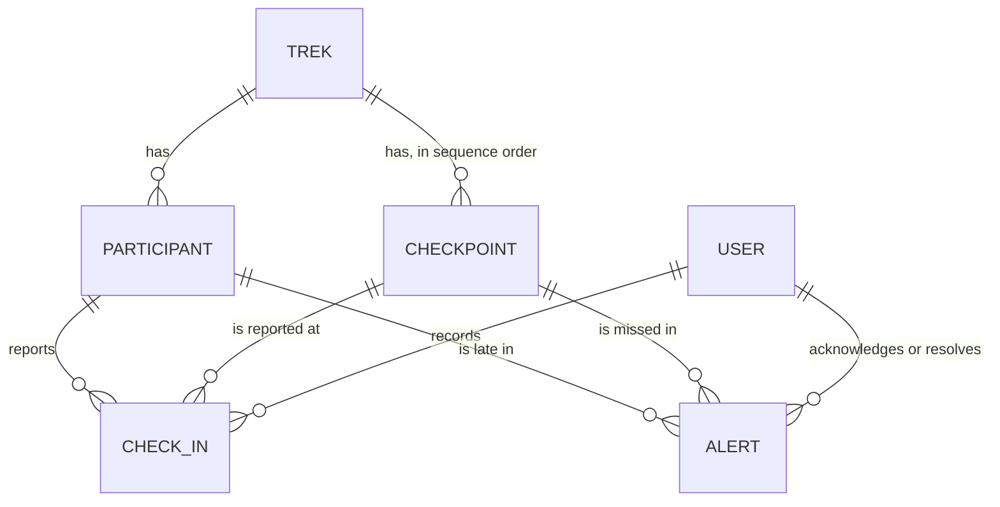
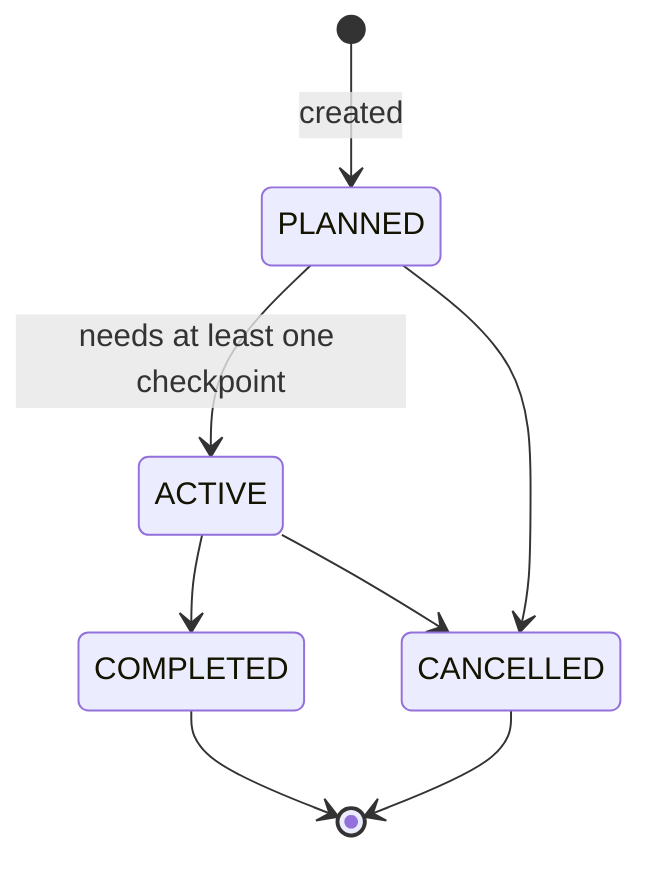
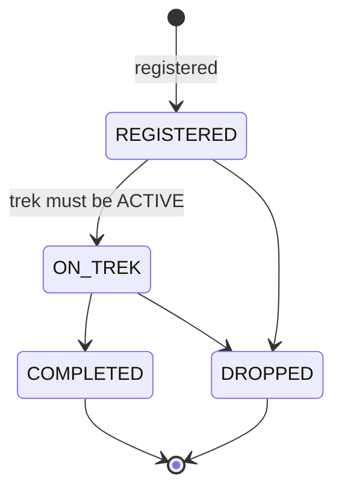
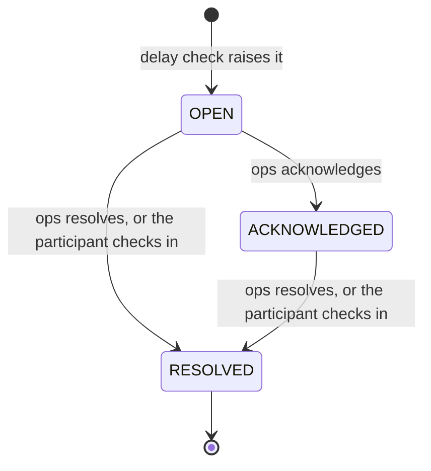

# Domain model

The service tracks treks, the checkpoints along each trek, the participants on a trek, their check-ins at checkpoints, and the alerts raised when a participant is late. Users of the API are operations staff and administrators.

The schema is created by Flyway (`src/main/resources/db/migration/V1__init_schema.sql`). Hibernate only validates it at startup (`ddl-auto: validate`).

## Entities

Every table has the same audit columns: `created_at`, `updated_at`, `created_by` and `updated_by`. Spring Data JPA auditing fills them on every save. The times come from the injected `Clock`. The user is the username in the request's JWT, or `system` for work outside a request, such as the delay check and the seed data. Every id is a UUID generated by the application.

| Entity | Table | Fields | Purpose |
|---|---|---|---|
| `User` | `users` | `username` (unique), `password_hash` (BCrypt), `role` | Someone who can log in. Role is `ADMIN` or `OPERATIONS`. |
| `Trek` | `treks` | `name`, `start_at`, `end_at`, `status` | One departure of a trek, with its planned start and end. |
| `Checkpoint` | `checkpoints` | `trek_id`, `name`, `sequence_no`, `expected_after_hours` | A point on the trek where participants should report. `expected_after_hours` counts from the trek start. |
| `Participant` | `participants` | `trek_id`, `name`, `phone`, `emergency_contact`, `status` | A person on one trek. |
| `CheckIn` | `check_ins` | `participant_id`, `checkpoint_id`, `checked_in_at`, `recorded_by` | A participant reported at a checkpoint. `recorded_by` is the user who entered it. |
| `Alert` | `alerts` | `participant_id`, `checkpoint_id`, `status`, `acknowledged_by`, `acknowledged_at`, `resolved_by`, `resolved_at` | A participant did not report at a checkpoint in time. Its created time is `created_at`. |

The expected time at a checkpoint is `trek.start_at + checkpoint.expected_after_hours`. It is computed when needed and not stored. The alert response returns it as `expectedAt`.

## Relationships

* A trek has many checkpoints and many participants. Each checkpoint and each participant belongs to exactly one trek.
* A check-in links one participant and one checkpoint of the same trek, and names the user who recorded it.
* An alert links one participant and one checkpoint, and may name the users who acknowledged and resolved it.
* All relationships are many-to-one from the child side. Foreign keys enforce them in the database.

## State transitions

Any other change is rejected with HTTP 422.

### Trek

Only an ADMIN changes trek status. Only `ACTIVE` treks are watched by the delay check and accept check-ins.

### Participant

Only `ON_TREK` participants are watched by the delay check. `REGISTERED` and `ON_TREK` participants can check in. `DROPPED` and `COMPLETED` participants cannot.

### Alert

Acknowledging and resolving record the user and the time. A check-in for the same participant and checkpoint resolves an `OPEN` or `ACKNOWLEDGED` alert, and the user who recorded the check-in becomes the resolver.

## Delay rule

A participant is delayed at a checkpoint when all of these hold:

1. The trek is `ACTIVE` and its start time has passed.
2. The participant is `ON_TREK`.
3. The current time is after `trek.start_at + checkpoint.expected_after_hours + grace`. The grace period is set by `DELAY_CHECK_GRACE_MINUTES` and defaults to 0.
4. The participant has no check-in at that checkpoint.
5. The participant has no alert for that checkpoint, in any status.

Each delayed pair gets one `OPEN` alert. Rule 5 makes the check safe to repeat. It also means a resolved alert is not raised again.

## Important constraints

Constraints enforced by the database (V1 migration):

* `users.username` is unique.
* `(checkpoints.trek_id, checkpoints.sequence_no)` is unique: one checkpoint per position on a trek.
* `(check_ins.participant_id, check_ins.checkpoint_id)` is unique: one check-in per participant and checkpoint. This also stops two requests that race.
* `CHECK` constraints limit each status and role column to its enum values.
* `treks.end_at > treks.start_at`.
* `checkpoints.sequence_no > 0` and `checkpoints.expected_after_hours >= 0`.
* Foreign keys on every relationship.

Rules enforced by the services:

* Checkpoints: the expected time must fall inside the trek (422). Expected hours must grow with the sequence number (422). A used sequence number is a 409. A `COMPLETED` or `CANCELLED` trek takes no new checkpoints (422).
* Participants: no registration on a `COMPLETED` or `CANCELLED` trek (422). A phone number has 7 to 20 digits, spaces, brackets or dashes (400).
* Check-ins:
  * The checkpoint must belong to the participant's trek (422).
  * The trek must be `ACTIVE` (422).
  * The participant must not be `DROPPED` or `COMPLETED` (422).
  * The time defaults to now and must not be in the future (422).
  * A second check-in at the same checkpoint is a 409.
* Alerts: at most one alert per participant and checkpoint (delay check).
