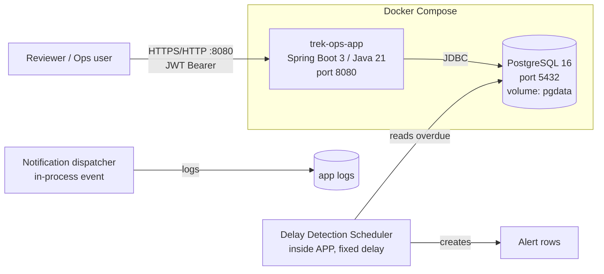
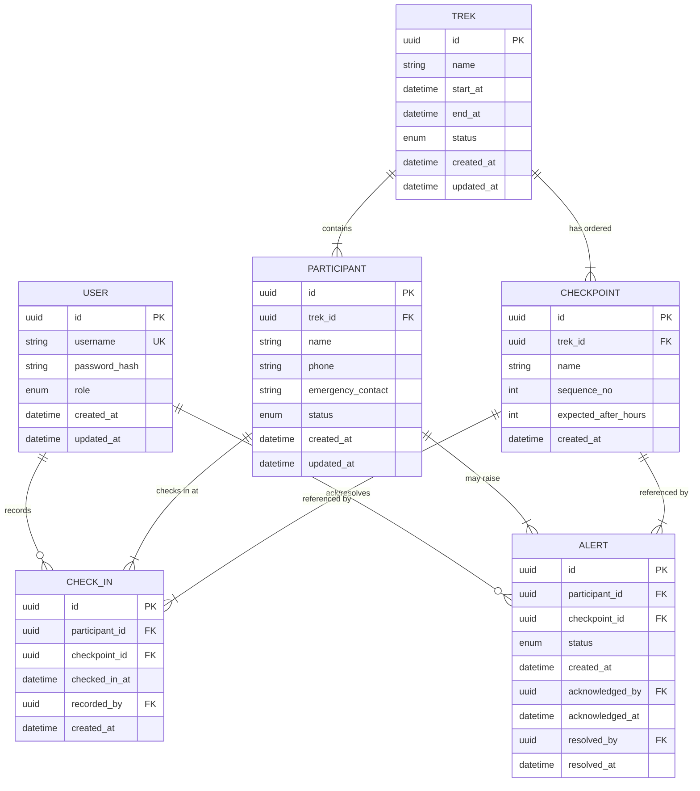
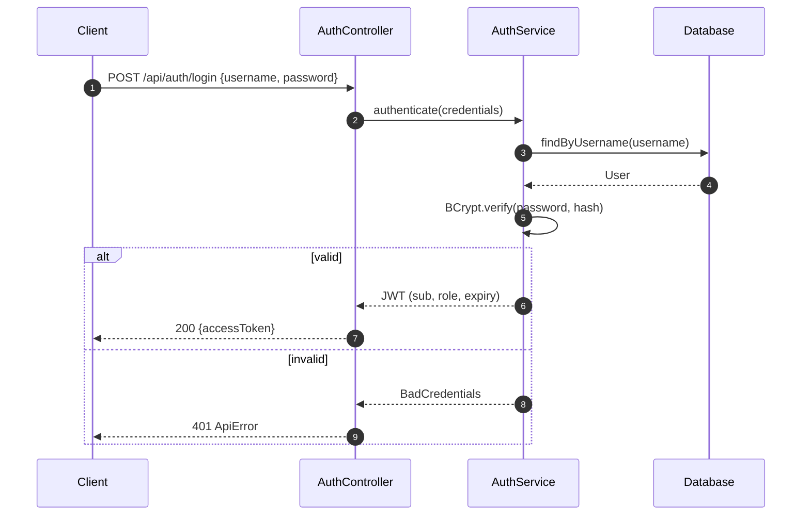
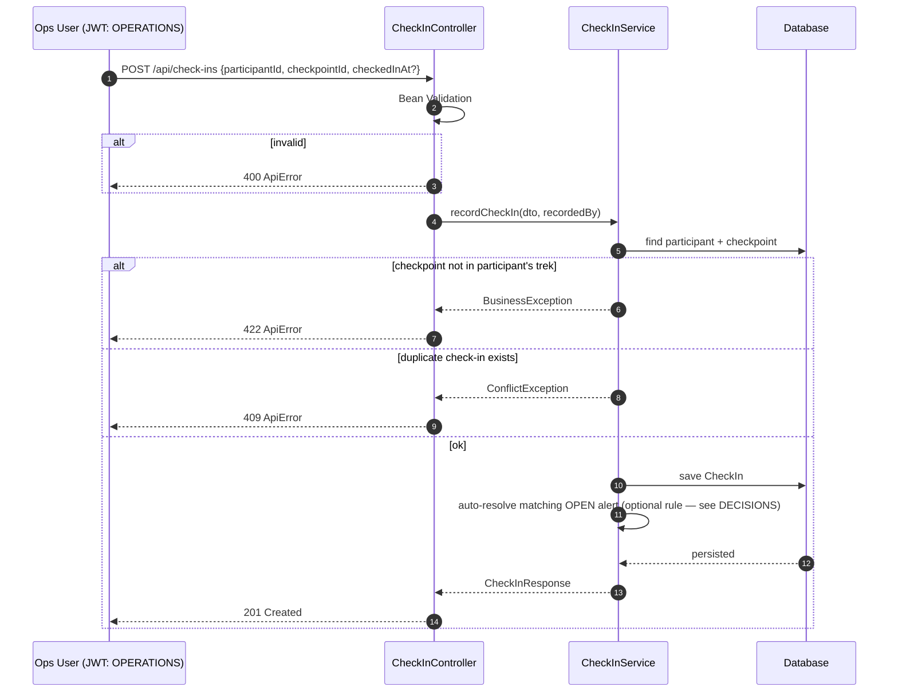
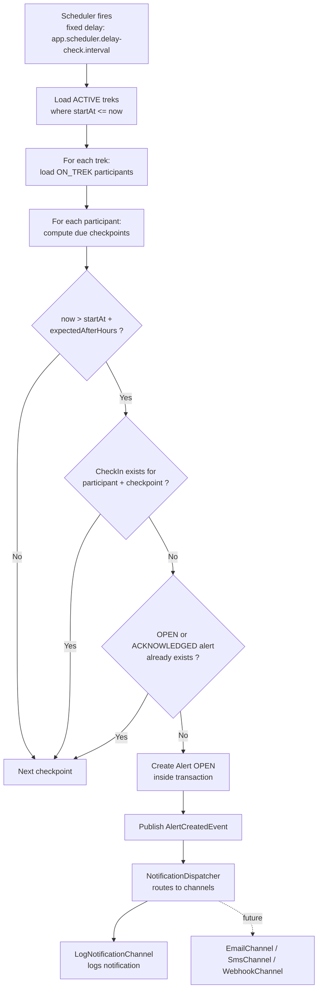
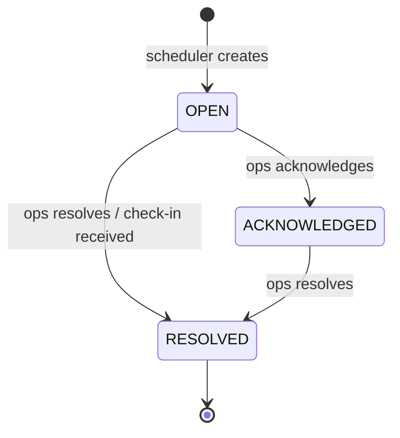
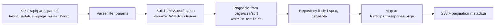
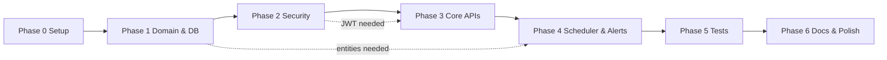

# Trek Operations Platform — Implementation Plan & Architecture

> Companion to `BE_Assignment_PRD_Latest.md`. This document is the single source of truth for *how* the assignment will be built.

---

## 1. Final Outcome (Definition of Done)

A private GitHub repo `indiahikes-backend-assignment-ArushNaudiyal` containing:

- A runnable Spring Boot 3 backend (Java 21, Gradle) that starts with **one command**: `docker compose up --build`.
- All 14 PRD requirements implemented: treks, checkpoints, participants, check-ins, delayed-participant detection via a background scheduler, alert management, RBAC-secured APIs, search, configuration, consistent errors, audit fields, public health endpoint, pluggable notification design, Swagger docs.
- Test suite: service-layer (JUnit + Mockito) and controller-layer (`@WebMvcTest`) tests covering the critical business flows.
- Documentation: `README.md`, `DOMAIN_MODEL.md`, `DECISIONS.md`, `SELF_REVIEW.md`, `TEST_NOTES.md` (all five are **required deliverables**, not optional).
- The owner can walk through every file in the follow-up discussion.

### Success criteria checklist

| # | Criterion | How verified |
|---|-----------|--------------|
| 1 | `docker compose up` brings up app + DB with seeded data | Manual smoke test |
| 2 | Login → JWT → role-gated API calls work | Integration test + Swagger |
| 3 | Scheduler creates an alert for an overdue participant | Service test with fixed clock |
| 4 | Scheduler never creates duplicate open alerts | Idempotency test |
| 5 | Participant search supports filter + pagination + sorting | Controller tests |
| 6 | Every error returns the same `ApiError` shape | Controller advice test |
| 7 | All 5 docs present and consistent with code | Review pass |

---

## 2. Tech Choices & Rationale (for DECISIONS.md)

| Area | Choice | Why | Trade-off accepted |
|------|--------|-----|--------------------|
| Language | Java 21 | PRD allows 17 or 21; 21 is current LTS with records & pattern matching useful for DTOs | Slightly newer than some interviewers' expectations — fine |
| Framework | Spring Boot 3.3.x | PRD-mandated | — |
| Build | Gradle (Kotlin DSL) | PRD-mandated; fast incremental builds | Groovy DSL more common in older repos; Kotlin DSL chosen for type safety |
| DB (runtime) | PostgreSQL 16 | Real DB for Docker Compose; industry standard, matches "database choice is yours" | Heavier than MySQL alternatives — none |
| DB (tests) | H2 (in-memory) | Zero-infra unit/integration tests | Dialect differences; mitigated by avoiding DB-specific SQL (JPA only) |
| Migrations | Flyway | Schema versioning, reproducible environments | Extra dependency; worth it for `docker compose` reproducibility |
| ORM | Spring Data JPA | Standard, fast to build, Specifications power the search API | N+1 risk — mitigated with `JOIN FETCH` where needed |
| AuthN | JWT (stateless) + Spring Security | Stateless fits Docker scaling story; easy to demo via Swagger | Token revocation is harder than sessions — noted as known limitation in SELF_REVIEW |
| AuthZ | Role-based: `ADMIN`, `OPERATIONS` | Matches two real user populations in the brief | Fine-grained per-resource ACLs out of scope |
| Scheduler | Spring `@Scheduled` (single fixed-delay job) | Simplest correct solution; PRD says approach is discretionary | Single-node only — documented; would move to ShedLock/Quartz for multi-node |
| Clock | `java.time.Clock` bean injected everywhere | Makes scheduler & delay logic testable with a fixed clock | Minor wiring overhead |
| Notifications | `ApplicationEventPublisher` + `NotificationChannel` interface | One-line extensibility for future channels (email/SMS/webhook) | In-process only; documented |
| API docs | springdoc-openapi (Swagger UI) | De-facto standard for Boot 3 | — |
| Error format | `@RestControllerAdvice` + `ApiError` record | One consistent shape everywhere | — |
| Audit | Spring Data JPA Auditing (`AuditorAware`) | Automatic created/updated metadata incl. "who" | Requires security context; falls back to `system` |
| Validation | Jakarta Bean Validation on request DTOs | Declarative, consistent 400 responses | — |
| Tests | JUnit 5 + Mockito + AssertJ + `@WebMvcTest` | PRD-mandated stack | — |
| Container | Multi-stage Dockerfile (Eclipse Temurin 21) + Compose | One-command run per PRD | Build time inside Docker is longer; layer caching mitigates |

---

## 3. Architecture

### 3.1 Style

**Layered (Controller → Service → Repository) with a domain-centric core.** Rules:

- Controllers are thin: validation via annotations, no business logic.
- Services own business rules (delay detection, alert idempotency, check-in validation).
- Repositories are Spring Data interfaces; no custom SQL unless unavoidable.
- DTOs decouple the API from JPA entities — entities never leave the service layer.
- Cross-cutting concerns (security, errors, audit) are handled by framework infrastructure, not scattered code.

```
┌─────────────────────────────────────────────────────────────┐
│                        Client (Swagger UI / curl)            │
└──────────────────────────────┬──────────────────────────────┘
                               ▼
┌─────────────────────────────────────────────────────────────┐
│  Controller layer  (@RestController, DTO in/out, validation) │
└──────────────────────────────┬──────────────────────────────┘
                               ▼
┌─────────────────────────────────────────────────────────────┐
│  Service layer     (business rules, transactions, events)    │
└──────────────┬───────────────────────────────┬──────────────┘
               ▼                               ▼
┌───────────────────────────┐   ┌─────────────────────────────┐
│  Repository layer (JPA)   │   │  Infrastructure             │
└───────────────┬───────────┘   │  • Security filter (JWT)    │
                ▼               │  • Scheduler (delay check)  │
┌───────────────────────────┐   │  • Notification dispatcher  │
│  PostgreSQL / H2 (tests)  │   │  • Exception advice         │
└───────────────────────────┘   │  • Auditing (dates + user)  │
                                └─────────────────────────────┘
```

### 3.2 Module / package structure

Root package: `com.indiahikes.trekops`

| Package | Contents |
|---------|----------|
| `config` | Security config, JWT filter, OpenAPI config, scheduling config, auditor config |
| `domain` | JPA entities + enums (`TrekStatus`, `ParticipantStatus`, `AlertStatus`, `UserRole`) |
| `repository` | Spring Data interfaces + Specifications for search |
| `service` | `TrekService`, `ParticipantService`, `CheckInService`, `AlertService`, `AuthService`, `DelayDetectionService`, `NotificationDispatcher` |
| `scheduler` | `DelayDetectionScheduler` (thin: calls service) |
| `notification` | `NotificationChannel` interface, `AlertCreatedEvent`, `LogNotificationChannel` |
| `web` | Controllers, request/response DTOs, `ApiError`, `GlobalExceptionHandler` |
| `web.mapper` | Entity ↔ DTO mappers (hand-written; no MapStruct to keep the dependency surface small) |
| `common` | `Clock` bean, pagination helpers |

### 3.3 Deployment architecture



---

## 4. Domain Model Summary (full detail goes in DOMAIN_MODEL.md)

### 4.1 Entities & key fields

| Entity | Key fields | Notes |
|--------|-----------|-------|
| `User` | id, username, password (BCrypt), role (`ADMIN`/`OPERATIONS`), audit | For auth |
| `Trek` | id, name, startDate, endDate, status (`PLANNED`/`ACTIVE`/`COMPLETED`/`CANCELLED`), audit | Only `ACTIVE` treks are scanned by scheduler |
| `Checkpoint` | id, trek (FK), name, sequenceNo, expectedAfterHours, audit | Sequence defines expected order |
| `Participant` | id, trek (FK), name, phone, emergencyContact, status (`REGISTERED`/`ON_TREK`/`COMPLETED`/`DROPPED`), audit | |
| `CheckIn` | id, participant (FK), checkpoint (FK), checkedInAt (timestamp recorded by ops), recordedBy (user FK), audit | Unique constraint: (participant, checkpoint) — one check-in per checkpoint per participant |
| `Alert` | id, participant (FK), checkpoint (FK), status (`OPEN`/`ACKNOWLEDGED`/`RESOLVED`), createdAt, acknowledgedBy/At, resolvedBy/At, audit | Idempotency rule below |

### 4.2 Critical business rules

1. **Delay definition**: a participant is *delayed at checkpoint C* when `now > trek.startDateTime + C.expectedAfterHours` AND no `CheckIn` exists for `(participant, C)`.
2. **Alert idempotency**: at most one `OPEN` or `ACKNOWLEDGED` alert per `(participant, checkpoint)`. Re-checking the same overdue pair must not duplicate. Enforced with a unique partial-index-style check in the service (`existsByParticipantAndCheckpointAndStatusIn`) inside a transaction.
3. **Check-in validation**: checkpoint must belong to the participant's trek; timestamp required (defaults to `now` if omitted); duplicate check-in rejected with 409.
4. **Scheduler scope**: only treks `ACTIVE` with `startDateTime <= now`; participants `ON_TREK` only (dropped/completed excluded — a key correctness detail).
5. **State transitions** (documented in DOMAIN_MODEL.md):
   - Trek: `PLANNED → ACTIVE → COMPLETED` or `→ CANCELLED` (ADMIN only)
   - Participant: `REGISTERED → ON_TREK → COMPLETED` or `→ DROPPED`
   - Alert: `OPEN → ACKNOWLEDGED → RESOLVED` (and `OPEN → RESOLVED`)

### 4.3 Entity relationship diagram



---

## 5. Core Flows (Mermaid)

### 5.1 Authentication flow



### 5.2 Check-in recording flow



### 5.3 Delay detection & alert generation (the heart of the assignment)



### 5.4 Alert management flow



### 5.5 Search API flow



### 5.6 Error handling flow

```mermaid
flowchart TD
    A[Request] --> B{Failure point}
    B -- Validation failed --> C[@Valid throws MethodArgumentNotValidException]
    B -- Auth failed --> D[AuthenticationEntryPoint]
    B -- Forbidden role --> E[AccessDeniedHandler]
    B -- Business rule violated --> F[BusinessException / ConflictException]
    B -- Entity not found --> G[ResourceNotFoundException]
    C & D & E & F & G --> H[GlobalExceptionHandler<br/>@RestControllerAdvice]
    H --> I["ApiError {timestamp, status, error, message, path}"]
    I --> J[Consistent JSON response]
```

---

## 6. REST API Surface (v1)

Base path: `/api`. All endpoints except `/auth/login` and `/health` require JWT.

| Method & path | Role | Purpose |
|---|---|---|
| `POST /api/auth/login` | public | Obtain JWT |
| `GET /api/health` | public | App name, version, status, DB up/down |
| `GET /api/treks` | ADMIN, OPERATIONS | List treks (paginated) |
| `POST /api/treks` | ADMIN | Create trek |
| `GET /api/treks/{id}` | ADMIN, OPERATIONS | Trek detail incl. checkpoints |
| `PATCH /api/treks/{id}/status` | ADMIN | Change trek status |
| `POST /api/treks/{id}/checkpoints` | ADMIN | Add checkpoint |
| `GET /api/participants` | ADMIN, OPERATIONS | Search: filters `trekId`, `status`, `name`, phone; pagination; sorting |
| `POST /api/participants` | ADMIN, OPERATIONS | Register participant |
| `GET /api/participants/{id}` | ADMIN, OPERATIONS | Participant detail incl. check-ins |
| `PATCH /api/participants/{id}/status` | ADMIN, OPERATIONS | Update status |
| `POST /api/check-ins` | ADMIN, OPERATIONS | Record check-in |
| `GET /api/alerts?status=` | ADMIN, OPERATIONS | List/filter alerts |
| `POST /api/alerts/{id}/acknowledge` | OPERATIONS | Acknowledge |
| `POST /api/alerts/{id}/resolve` | OPERATIONS | Resolve |

**Role-permission matrix** (documented in README + DECISIONS):

| Capability | ADMIN | OPERATIONS |
|---|---|---|
| Login / health | ✅ | ✅ |
| Read treks, participants, alerts | ✅ | ✅ |
| Record check-ins | ✅ | ✅ |
| Manage alerts (ack/resolve) | ✅ | ✅ |
| Create treks / checkpoints | ✅ | ❌ |
| Change trek status | ✅ | ❌ |
| Register participants | ✅ | ✅ |

---

## 7. Implementation Plan (8–10 hour breakdown)

### Phase 0 — Setup (≈ 1 h)

1. Create **private** GitHub repo `indiahikes-backend-assignment-ArushNaudiyal`. Collaborators (`KartikWatts`, `Manasa-NL`) are deferred.
2. Spring Initializr skeleton: Boot 3.3, Java 21, Gradle Kotlin DSL, deps: web, security, data-jpa, validation, flyway, postgresql, h2 (test), jjwt, springdoc-openapi, lombok (or Java records only — see decision below).
3. Multi-stage `Dockerfile` + `docker-compose.yml` (app + postgres + healthcheck + depends_on).
4. README skeleton, `.gitignore`, Gradle wrapper committed.

**Deliverable:** `docker compose up` runs an empty app.

### Phase 1 — Domain & persistence (≈ 1.5 h)

1. Entities + enums (Section 4) with audit fields.
2. Repositories + the alert-idempotency query + participant Specifications.
3. Flyway migration `V1__init.sql` + `V2__seed.sql` (admin user, sample Kedarkantha trek with the PRD's exact checkpoint table, 3 participants).
4. Manual verification via H2/pgAdmin or psql.

**Deliverable:** schema + seed data load cleanly.

### Phase 2 — Security (≈ 1.5 h)

1. `SecurityConfig` (stateless JWT filter, role rules from Section 6).
2. `JwtService` (issue/parse, HS256, key from config) + `JwtAuthFilter`.
3. `AuthController` + login DTOs; BCrypt password encoder.
4. `AuditorAware` reading the JWT principal; fallback `system`.

**Deliverable:** login returns JWT; endpoints enforce roles (verify with curl).

### Phase 3 — Core APIs (≈ 2 h)

1. Treks + checkpoints endpoints.
2. Participants endpoints incl. search (`Specification` + `Pageable`).
3. Check-in endpoint with the three validations (trek match, duplicate, timestamp).
4. Global exception handler + `ApiError` record + validation error field map.
5. OpenAPI config (JWT security scheme in Swagger UI).

**Deliverable:** full CRUD flows pass via Swagger UI.

### Phase 4 — Scheduler, alerts, notifications (≈ 1.5 h)

1. `Alert` entity + repository + alert endpoints (list, acknowledge, resolve).
2. `DelayDetectionService` with injected `Clock` (pure, testable logic per Section 5.3).
3. `DelayDetectionScheduler` with configurable fixed delay.
4. `AlertCreatedEvent` + `NotificationChannel` interface + `LogNotificationChannel`.
5. Decide + implement: check-in auto-resolves matching OPEN alert (documented trade-off).

**Deliverable:** seed a participant overdue per seed data → alert appears; second run creates nothing new (idempotent).

### Phase 5 — Tests (≈ 1.5 h)

See Section 8. Target: green `gradle test` with meaningful coverage of business flows.

### Phase 6 — Docs & polish (≈ 1 h)

1. README (setup, build, run, Docker, auth, test commands, seed data).
2. DOMAIN_MODEL.md, DECISIONS.md, SELF_REVIEW.md, TEST_NOTES.md.
3. Final `docker compose up` end-to-end pass.
4. **Collect AI session logs** (PRD asks for them if AI tools were used — export this conversation).

**Deliverable:** submission-ready repo.

### Task dependency graph



---

## 8. Testing Scope

### 8.1 Strategy

- **Unit tests (service layer)** — JUnit 5 + Mockito: business logic isolated, `Clock` fixed/stubbed. This is where the delay-detection rules and idempotency are proven.
- **Slice tests (controller layer)** — `@WebMvcTest` + `@WithMockUser`: request/response shape, validation → 400, security (401 without token, 403 wrong role), pagination/sort parameters.
- **Integration smoke** — `@SpringBootTest` with H2 for auth login flow and Flyway migration validity (catches schema/entity mismatches).
- **Manual/E2E** — scripted via Swagger/curl against the Docker Compose stack (documented commands in TEST_NOTES.md).

### 8.2 Test inventory (minimum)

| # | Test | Layer | Asserts |
|---|------|-------|---------|
| 1 | Delay detection: due + no check-in → alert created | Service | Alert saved, event published |
| 2 | Delay detection: not yet due → nothing | Service | No repository save |
| 3 | Delay detection: due + check-in exists → nothing | Service | No alert |
| 4 | Idempotency: existing OPEN alert → no duplicate | Service | `existsBy...` called, no save |
| 5 | Scheduler skips non-ACTIVE treks and non-ON_TREK participants | Service | Boundary correctness |
| 6 | Check-in rejected when checkpoint belongs to another trek | Service | Exception → 422 |
| 7 | Duplicate check-in → conflict | Service | Exception → 409 |
| 8 | Login: valid creds → JWT; invalid → 401 | Controller / Integration | Token claims incl. role |
| 9 | RBAC: OPERATIONS cannot create trek → 403 | Controller | `@WithMockUser(roles=OPERATIONS)` |
| 10 | Unauthenticated request → 401 | Controller | EntryPoint behaviour |
| 11 | Validation failure → 400 with field errors | Controller | `ApiError` shape + `errors` map |
| 12 | Participant search: filters compose, page/sort applied | Controller + Service spec | Spec arguments, page metadata |
| 13 | Alert acknowledge → status transition, invalid transition rejected | Service | State machine rules |
| 14 | Global handler: unknown entity → 404 `ApiError` | Controller | Consistent error body |

### 8.3 Commands

```bash
./gradlew test                 # all tests
./gradlew test --tests '*DelayDetectionServiceTest'
./gradlew build                # tests + jar
docker compose up --build      # full stack
```

### 8.4 Out of scope (state in TEST_NOTES.md)

- Performance/load testing
- Contract testing
- Multi-node scheduler behaviour
- Real notification delivery

---

## 9. Environments & Configuration

### 9.1 Profiles

| Profile | DB | Purpose |
|---|---|---|
| `default` | PostgreSQL via env vars | Docker Compose runtime |
| `test` | H2 in-memory | `gradle test` |
| `local` | H2 file or local PG (optional) | IDE development without Docker |

### 9.2 Externalized configuration (`application.yml`)

```yaml
app:
  security:
    jwt-secret: ${JWT_SECRET:change-me-in-prod}
    token-ttl-minutes: ${TOKEN_TTL_MINUTES:480}
  scheduler:
    delay-check:
      enabled: ${DELAY_CHECK_ENABLED:true}
      interval-ms: ${DELAY_CHECK_INTERVAL_MS:60000}
  notifications:
    channels: ${NOTIFICATION_CHANNELS:log}

spring:
  datasource:
    url: ${DB_URL:jdbc:postgresql://db:5432/trekops}
    username: ${DB_USER:trekops}
    password: ${DB_PASSWORD:trekops}
```

**Demonstrates requirement 9:** behavior (scheduler on/off + interval, notification channels, JWT TTL) is externally configurable — a talking point for the discussion.

### 9.3 Secrets

- Compose injects `JWT_SECRET` / `DB_PASSWORD` via `.env` (git-ignored); defaults only for local convenience.
- Never commit real secrets — `.env.example` committed instead.

---

## 10. Repository Structure

```txt
indiahikes-backend-assignment-ArushNaudiyal/
├── Dockerfile
├── docker-compose.yml
├── .env.example
├── .gitignore
├── README.md
├── DOMAIN_MODEL.md
├── DECISIONS.md
├── SELF_REVIEW.md
├── TEST_NOTES.md
├── build.gradle.kts
├── settings.gradle.kts
├── gradle/
│   └── wrapper/
├── gradlew / gradlew.bat
└── src/
    ├── main/
    │   ├── java/com/indiahikes/trekops/
    │   │   ├── TrekOpsApplication.java
    │   │   ├── common/
    │   │   │   └── TimeConfig.java              # Clock bean
    │   │   ├── config/
    │   │   │   ├── SecurityConfig.java
    │   │   │   ├── OpenApiConfig.java
    │   │   │   ├── SchedulingConfig.java
    │   │   │   └── JpaAuditingConfig.java
    │   │   ├── domain/
    │   │   │   ├── User.java
    │   │   │   ├── Trek.java
    │   │   │   ├── Checkpoint.java
    │   │   │   ├── Participant.java
    │   │   │   ├── CheckIn.java
    │   │   │   ├── Alert.java
    │   │   │   └── enums/ (UserRole, TrekStatus, ParticipantStatus, AlertStatus)
    │   │   ├── repository/
    │   │   │   ├── UserRepository.java
    │   │   │   ├── TrekRepository.java
    │   │   │   ├── CheckpointRepository.java
    │   │   │   ├── ParticipantRepository.java    # + Specifications
    │   │   │   ├── CheckInRepository.java
    │   │   │   └── AlertRepository.java
    │   │   ├── service/
    │   │   │   ├── AuthService.java
    │   │   │   ├── TrekService.java
    │   │   │   ├── ParticipantService.java
    │   │   │   ├── CheckInService.java
    │   │   │   ├── AlertService.java
    │   │   │   └── DelayDetectionService.java
    │   │   ├── scheduler/
    │   │   │   └── DelayDetectionScheduler.java
    │   │   ├── notification/
    │   │   │   ├── AlertCreatedEvent.java
    │   │   │   ├── NotificationChannel.java
    │   │   │   ├── NotificationDispatcher.java
    │   │   │   └── LogNotificationChannel.java
    │   │   └── web/
    │   │       ├── AuthController.java
    │   │       ├── TrekController.java
    │   │       ├── ParticipantController.java
    │   │       ├── CheckInController.java
    │   │       ├── AlertController.java
    │   │       ├── HealthController.java
    │   │       ├── dto/ (request + response records)
    │   │       ├── mapper/
    │   │       ├── ApiError.java
    │   │       └── GlobalExceptionHandler.java
    │   └── resources/
    │       ├── application.yml
    │       ├── application-test.yml
    │       └── db/migration/
    │           ├── V1__init_schema.sql
    │           └── V2__seed_data.sql
    └── test/
        └── java/com/indiahikes/trekops/
            ├── service/
            │   ├── DelayDetectionServiceTest.java
            │   ├── CheckInServiceTest.java
            │   └── AlertServiceTest.java
            ├── web/
            │   ├── AuthControllerTest.java
            │   ├── ParticipantControllerTest.java
            │   ├── CheckInControllerTest.java
            │   └── GlobalExceptionHandlerTest.java
            └── integration/
                └── AuthIntegrationTest.java
```

---

## 11. Risks & Mitigations

| Risk | Impact | Mitigation |
|---|---|---|
| Scheduler duplicates alerts under concurrent runs | Wrong alert counts → looks careless | DB-level unique guard where possible + service-level existence check in transaction; explicit test (#4) |
| Scope creep eats the 8–10 h budget | Unfinished submission | This plan is the scope; anything extra goes to SELF_REVIEW "future improvements" |
| JWT revocation question in discussion | Follow-up stumble | Pre-write the answer: short TTL + stateless trade-off; mention refresh/revocation list as production improvement |
| Docker build issues on reviewer's machine | "Won't run" fail | Test `docker compose up` on a clean checkout; pin versions; include `depends_on` healthchecks |
| Can't explain AI-assisted code | Trust penalty | Owner reviews every file; SELF_REVIEW.md discloses AI usage + which parts were reviewed most carefully |
| Session logs not available at deadline | PRD compliance gap | Export AI conversation logs **now** into `ai-logs/` during the build |

---

## 12. Follow-up Discussion Prep (likely questions → answers to prepare)

1. **Domain model** — walk the ER diagram; justify `expectedAfterHours` vs absolute timestamps (offsets survive trek rescheduling).
2. **Scheduler** — why `@Scheduled` not Quartz/ShedLock? (single-node scope, documented). How is it idempotent?
3. **Concurrency** — what happens if scheduler and check-in creation race? (Unique constraint + transactional existence check; last-writer-safe statuses.)
4. **Security** — why JWT? Role design? Where do secrets live in production?
5. **Delay logic edge cases** — participant joins late? checkpoint times crossed while scheduler was down? (Batch catch-up: rule is evaluated from data, not from missed runs.)
6. **What would change before production?** — refresh tokens, ShedLock, real notification channels, observability (Micrometer), rate limiting, HTTPS.

---

*Plan version 1.0 — 2026-10-09. Adjust scope only by moving items to SELF_REVIEW's "future improvements", never by skipping tests or docs.*
